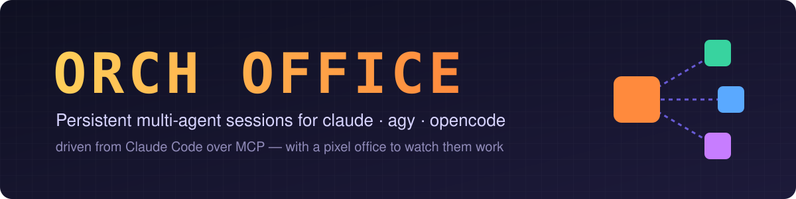
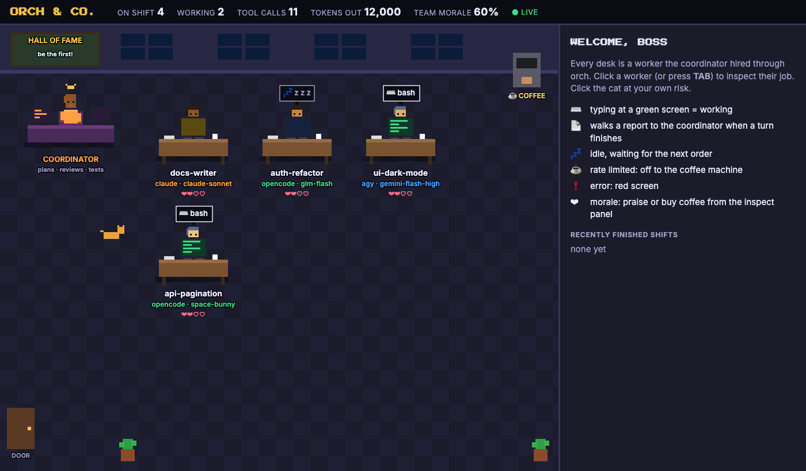
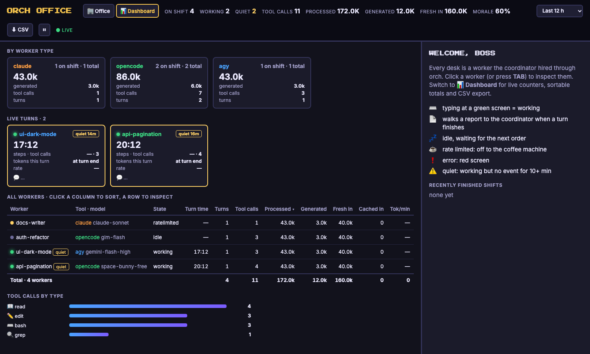
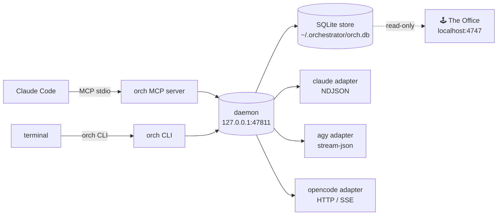

<div align="center">



<br/>

[](https://nodejs.org)
[](tsconfig.json)
[](https://modelcontextprotocol.io)
[](#-tests)
[](LICENSE)

**One coordinator. Many AI workers. Real conversations, not one-shot tasks.**

[Quick start](#-quick-start) · [Features](#-features) · [The Office](#-the-office) · [MCP tools](#-mcp-tools) · [CLI](#-cli) · [Permissions](#-permissions) · [Architecture](#-architecture)

</div>

---

ORCH OFFICE turns **Claude Code** into a team lead. It starts **claude**, **agy** (Antigravity / Gemini) and
**opencode** (any provider: Zen, NVIDIA NIM, OpenRouter, …) as **long-lived worker sessions**, gives them one
normalized event stream, and lets Claude Code plan, delegate, review and test while the workers do the heavy lifting
**in parallel**.

The defining property is **persistence**: a session is a live process you hold a multi-turn conversation with.
Turn 2 sees turn 1's context.

## ✨ Features

| | |
|---|---|
| 🧠 **Persistent sessions** | `orch_open` once, `orch_send` many times; context is kept between turns |
| 🔀 **Three backends, one interface** | claude (NDJSON), agy (stream-json), opencode (HTTP/SSE) all emit the same event union |
| ⚡ **Run workers concurrently** | each session is its own process; long turns keep running in the daemon while you work |
| 🌳 **Worktree isolation** | `--worktree` gives each agent its own git worktree, then `diff` → `merge` or `discard` |
| 🔐 **Your permissions are the ceiling** | Claude Code's settings are translated per backend; callers can only *narrow* them |
| 🆚 **Cross-model compare** | ask several models the same question side by side |
| 💸 **Cost and token tracking** | per session and in total (`orch_cost`) |
| 🕹️ **The Office** | a pixel-art "IT company" dashboard showing every worker live, and what it is doing |
| 🗝️ **No keys stored** | every CLI uses its own login/config; orch never sees or saves API keys |

## 🚀 Quick start

**Requirements:** Node.js ≥ 22 (uses `node:sqlite`) and at least one worker CLI on your `PATH`
(`claude`, `agy` and/or `opencode`), already logged in with its own providers.

### 🍏 macOS / Linux

```bash
git clone https://github.com/zakivibes/ORCH-OFFICE-.git orch-office
cd orch-office
npm install && npm run build
npm test                                   # optional: 36 unit tests

# hand it to Claude Code / OpenCode
claude mcp add --scope user orchestrator -- node "$PWD/dist/mcp/run.js"

# optional: the terminal CLI
ln -sf "$PWD/dist/cli/main.js" ~/.local/bin/orch
```

### 🪟 Windows (10 / 11)

```powershell
git clone https://github.com/zakivibes/ORCH-OFFICE-.git orch-office
cd orch-office
npm install
npm run build
npm test                                   # 36 unit tests pass on Windows

# Global CLI linking (PowerShell / CMD)
npm link

# Launch The Office Dashboard
npm run office
# or double-click start-office.bat
```

### 🚀 One-Click Orchestra (`orch up` / Web UI)

You can launch a full multi-agent workforce in any directory with one command or click:

```powershell
# Launch all workers in your project directory & auto-open Coordinator CLI:
orch up --cwd "D:\MyProject" --terminal

# Shut down all live worker sessions:
orch down
```

Or open `http://localhost:4747` and click **`[🚀 Team launcher]`** to dynamically customize workers, models, and working directories from the UI.

Then just ask Claude Code something like:

> *"Open two opencode workers and one agy worker. Give each a separate part of the feature, run them in parallel, then review their diffs and run the tests."*

The MCP server starts the daemon on demand (`127.0.0.1:47811`). State lives in `~/.orchestrator/`
(`daemon.json`, `orch.db`, `logs/`).

> [!IMPORTANT]
> After rebuilding, stop the running daemon (pid in `~/.orchestrator/daemon.json`). A daemon started
> before the build keeps running the old code until it exits.

## 🕹️ The Office

<p align="center"></p>

A local, read-only pixel office for watching your workers. Each worker gets a desk: green screen = working,
💤 = idle, ☕ = rate-limited (off to the coffee machine), red screen = error. When a turn finishes the worker
walks its report over to the coordinator.

Switch to **📊 Dashboard** for live tracking and counting:

<p align="center"></p>

- **Live turns**: one card per running turn with a ticking clock, steps, tool calls, tokens so far and tokens/min.
  A worker that has gone quiet for 10+ minutes (`ORCH_STALL_MINUTES`) is flagged.
- **Every worker in one sortable table**: turns, tool calls, processed / generated / fresh / cached tokens and a
  per-turn trend line, with team totals. **⬇ CSV** exports it.
- **Totals by worker type** and **tool calls by type** across the team.
- **Inspect panel** (click any worker): Overview (live turn, token split, tool breakdown), Activity (tool calls and
  what the worker said, filterable), Turns (per-turn duration and tokens), Files (what it edited), Orders.
- **Window**: count only who is on shift, or the last 1 h to 7 days. Pause freezes the view.
- Deep links: `?view=dash&w=<session-id-prefix>&tab=files`.

Token counts for opencode workers are read live from opencode's own ledger (every step, even mid-turn); agy
reports per step and per turn. "Processed" includes cached input, which is the conversation re-read on every step
and dominates long agentic turns; "generated" is what the model actually wrote.

```bash
npm run office          # your real workers → http://localhost:4747
npm run office:demo     # preview with sample workers
```

It opens `~/.orchestrator/orch.db` (and opencode's database, if present) read-only and never writes to either.

### 🕸 Code graph (optional, graphify)
With [graphify](https://github.com/Graphify-Labs/graphify) installed (`uv tool install graphifyy`),
build an offline code graph in the project (`graphify update . --no-cluster && graphify tree --root .`)
and the Office's **🕸 Graph** button opens it. Workers can query it from the shell
(`graphify explain "Symbol"`, `graphify query "..." --budget 800`) instead of reading whole files;
the CLI adds no per-step tokens, unlike registering its MCP server.

## 🧰 MCP tools

| Tool | What it does |
|---|---|
| `orch_open` | start a persistent session (claude / agy / opencode) with a first prompt; optional `model`, `label`, `worktree`, `deny` |
| `orch_send` | send another turn to a live session (context preserved) |
| `orch_stream` | read a session's events since a sequence number |
| `orch_list` / `orch_status` | sessions, live state, token totals and the effective permission policy |
| `orch_interrupt` / `orch_close` | abort the current turn / end the session |
| `orch_diff` / `orch_merge` / `orch_discard` | review and land (or drop) a worktree session's changes |
| `orch_compare` | the same prompt to several models, side by side |
| `orch_models` | models opencode can actually reach |
| `orch_cost` | spend and tokens across sessions |
| `orch_roots` | directories the workers are confined to |

## 💻 CLI

```bash
orch open agy "Remember the code word X. Reply ACK"   # start session + first turn
orch send <id> "What was the code word?"              # continue, context preserved
orch ls [--live]   orch status <id>   orch logs <id>
orch interrupt <id>   orch close <id>   orch roots   orch cost   orch doctor
orch compare "what makes a good commit message?" --models opencode/space-bunny-free,opencode/big-pickle
orch models "opencode/"
```

Short session ids work everywhere (`orch send 40d4f87a "..."`).

### Worktree isolation for parallel agents

Two agents editing the same checkout overwrite each other. Give each session
its own git worktree:

```bash
orch open agy "refactor auth" --worktree --label auth &
orch open agy "add pagination" --worktree --label page &
orch diff <id> --stat        # what did it change?
orch diff <id>               # full patch, for review
orch merge <id>              # squash into the base branch
orch discard <id>            # throw the work away
orch sweep                   # reclaim trees orphaned by dead agents
```

`--worktree` creates `.orch/<label>` on branch `orch/<label>` and runs the
agent inside it. `orch diff` compares against the base **working tree**, not
`HEAD`, because agents usually edit without committing — diffing `base...HEAD`
reports "no changes" for an agent that did exactly what you asked.

`orch merge` commits the agent's uncommitted work on the branch first, then
squashes, because `git merge --squash` only sees commits.

Safety properties:
- A discarded run costs one `git worktree remove`; the main branch is untouched.
- A lock file (`.orch-lock`) records the owning pid. `discard` refuses while a
  live agent holds the tree; `sweep` removes trees whose owner is gone and runs
  automatically at daemon start, so a crash cannot leak worktrees forever.
- `.orch/` and `.orch-lock` are written to `.git/info/exclude`, so bookkeeping
  never lands in an agent's commit.

A worktree isolates **files**, not ports, databases or background processes.
Two agents both binding :3000 will still collide.

### Models

`orch_open` defaults opencode to `opencode/space-bunny-free`. Override per call with `model`
(`provider/model`, e.g. any provider you configured in opencode) or globally with `ORCH_OPENCODE_MODEL`.
This deliberately does **not** follow opencode's own default, which may point at a provider with no working
credentials.

## 🔐 Permissions

**Claude Code's settings are the ceiling.** Workers cannot exceed what Claude
Code itself is allowed to do.

Resolution order (highest first): managed → `--settings` →
`.claude/settings.local.json` → `.claude/settings.json` → `~/.claude/settings.json`.
Lists **merge** across levels; `deny` > `ask` > `allow`.

- Worker paths are confined to the directories Claude Code granted
  (`CLAUDE_PROJECT_DIR`, plus anything in `ORCH_EXTRA_ROOTS`).
- Tool-call arguments may only **narrow** permissions. `deny` and
  `disableTools` subtract; nothing the caller passes can widen a grant.
- With no matching rule: read-only tools default to `allow`, mutating tools
  (`Bash`, `Edit`, `Write`, `NotebookEdit`, `MultiEdit`) default to `ask`.

Per-backend fidelity:

| Backend | Fidelity | Mechanism |
|---|---|---|
| claude | `native` | `--allowedTools` / `--disallowedTools` / `--permission-mode`; rules are 1:1 |
| opencode | `native` | generated `permission` block via `OPENCODE_CONFIG_CONTENT` |
| agy | `mediated` | no per-rule list exists; uses `--mode` derived from the resolved `defaultMode` |

agy's mode matters more than it looks. Treating a Claude Code session whose
`defaultMode` is `auto` as "edits not permitted" forces `--mode plan`; agy then
tries to run a command, the command is refused, and it returns an **empty
reply with no error**. The mode is therefore derived from `defaultMode`, with
an explicit `Edit` allow/deny rule taking precedence.

agy is genuinely weaker here — `orch status` reports `mediated` rather than
pretending parity.

### Worker shell / full permissions (opt-in)

Headless workers cannot ask a human mid-turn: without a grant, agy auto-denies
commands and opencode hangs on an unanswered `ask`. To let workers run shell
commands and edit freely, the owner opts in explicitly:

```bash
echo '{"workerShell": true}' > ~/.orchestrator/config.json
```

It only takes effect when Claude Code's `defaultMode` is `auto` or
`bypassPermissions`. Then opencode gets `allow` for everything except your
deny rules and any `deny` narrowings passed on `orch_open` (e.g.
`["Bash(ssh *)", "Bash(git push *)"]`), which are emitted last so they win.
agy gets `--dangerously-skip-permissions` (it has no rule list, so state any
limits in the prompt too). The file is read on every spawn; no restart needed.

### ⏱️ Long turns

`orch_open` / `orch_send` wait at most `ORCH_MAX_WAIT_MS` (default 240000 ms)
and then return what they have; the turn keeps running in the daemon. Follow it
with `orch_stream`; `orch_send` answers "session busy" until the turn ends.

## ⚙️ Configuration

| Variable / file | Default | Purpose |
|---|---|---|
| `ORCH_PORT` | `47811` | daemon port |
| `ORCH_MAX_WAIT_MS` | `240000` | longest an MCP call waits before returning (the turn keeps running) |
| `ORCH_OPENCODE_MODEL` | `opencode/space-bunny-free` | default opencode model |
| `ORCH_EXTRA_ROOTS` | — | extra directories workers may touch |
| `ORCH_DEBUG` | — | verbose daemon logging |
| `~/.orchestrator/config.json` | — | `{"workerShell": true}` opt-in for worker shell / full permissions |
| `~/.orchestrator/config.json` → `workerMcp` | — | `{"disable": ["Blender"], "add": {...}}`: which MCP servers opencode workers get. Every enabled server's tool definitions ride along in **every** request, so switch off the ones workers never use (measured: 4 unused servers = 16k of a 49k-token baseline per step) |
| `~/.orchestrator/config.json` → `workerEnv` | — | `{"OPENCODE_DISABLE_CLAUDE_CODE_SKILLS": "1", "OPENCODE_DISABLE_EXTERNAL_SKILLS": "1"}`: extra environment for opencode workers. These two stop opencode listing every installed skill in each request (measured: ~3.5k tokens per step). Keep the project's `AGENTS.md` short too: opencode sends it with every request |
| `~/.orchestrator/limits.json` | 250 steps / 60M tokens | per-turn step cap and per-session read-token budget, with per-model `overrides` (e.g. no budget for a free provider) |
| `ORCH_DB` (office) | `~/.orchestrator/orch.db` | database the office reads |

## 🏗️ Architecture



- `src/core/` — daemon, client, registry, SQLite store (WAL), async queue, worktrees
- `src/adapters/` — one per CLI, all emitting the same event union
- `src/permissions/` — settings resolution, policy, per-backend translation
- `src/mcp/`, `src/cli/` — the two surfaces
- `office/` — the pixel dashboard (zero dependencies)

Normalized events: `session.started`, `turn.started`, `text.delta`, `tool.call`, `tool.result`,
`permission.request`, `turn.completed`, `error`. Usage is normalized to tokens; `costUsd` is authoritative
only for claude.

### Why not an existing dispatcher?

`aid` (github.com/agent-tools-org/ai-dispatch) already orchestrates all three
CLIs, but its agent contract is explicitly one-shot. From its own error output:

> Task t-9c00f43f uses 'agy' in one-shot print mode and cannot consume
> interactive input... retry starts a fresh session for agents without resume

So it cannot provide persistent sessions. It remains a good reference for
worktree isolation and DAG scheduling.

## 🧪 Tests

```bash
npm test
```

35 tests: permission precedence and narrowing, rule-glob anchoring, root confinement, the async-queue and
coalescer regressions, NDJSON parsing, store round-trips, fixture replays of real captured claude/agy streams,
and worktree behaviour (isolation, uncommitted diffs, squash-merge, lock refusal, stale sweep, branch-name
sanitising against `git check-ref-format`).

## ⚠️ Known limits

- Rate limits surface as `error` with `kind: "rate_limit"` and
  `retryAfterMs`; they are not retried automatically.
- Tool results are never inlined into MCP responses (Claude Code caps output
  around 25k tokens). Full transcripts go to `~/.orchestrator/logs/<id>.ndjson`.
- opencode token counts are read from the latest `message.updated`, so a turn's
  reported input tokens can be lower than the true context size. Cost is only
  authoritative for claude.
- Free Zen models can be rate-limited upstream; that surfaces as
  `error { kind: "api" }` with the provider's message.
- The three CLIs ship fast. Event schemas are pinned by fixture tests, which
  fail loudly on drift rather than failing silently at runtime.
## 🤝 Contributing

Issues and PRs are welcome. Please run `npm run typecheck && npm test` before opening a PR, and never commit
API keys: workers read credentials from each CLI's own config, never from this repo.

## 📄 License

[ISC](LICENSE) © Abdullah Zaki
